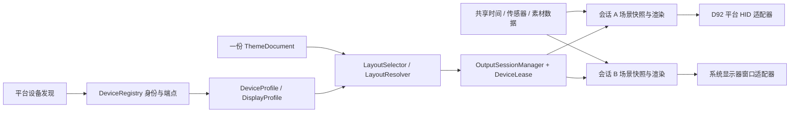

# Studio Display 多设备、多分辨率与主题自适应架构分析

日期：2026-10-22。状态：设计提案，尚未实施，等待确认。

后续状态：用户已确认实施，现已完成阶段 1 的平台无关契约、适配规则、V1 只读转换及虚拟目标测试。详见 `MULTI_DEVICE_FOUNDATION_ACCEPTANCE.md`；下文保留原始分析时态，后续生产会话/UI/格式写回尚未接入。

阶段2后续状态：已实现默认关闭的Windows会话运行时、注册表、租约、独立场景和兼容入口设备锁，并完成离线回归，详见 `MULTI_DEVICE_SESSIONS_ACCEPTANCE.md`。多设备UI、跨端点人工身份关联、实机多设备/长测和格式写回尚未完成，不能由离线结果推断硬件验收。

阶段3后续状态：设备管理卡片、逐设备/所选设备控制、当前连接确认及偏好sidecar已接入，默认发现/UI开启但不自动输出，详见 `MULTI_DEVICE_PAGE_ACCEPTANCE.md`。创作中心目标预览和多布局编辑、跨端点物理关联、格式写回及实机验收仍待完成。

创作中心后续状态：已接入真实目标设备预览、适配诊断及单/所选设备应用入口，共用场景准备且不修改源主题。详见 `CREATOR_DEVICE_PREVIEW_ACCEPTANCE.md`。多布局版本编辑/文件写回、跨端点物理关联及实机多设备验收仍待完成。

多布局后续状态：编辑源V2已支持命名布局保存/复制/删除、适配结果进入编辑器微调、独立视图状态和全部布局素材链路；设备偏好增加人工物理组，新管理会话接入组租约。详见 `MULTI_LAYOUT_WORKFLOW_ACCEPTANCE.md`。当前只发现1台D92，真实双设备验收仍待完成；旧单设备入口不自动使用物理组，不宣称所有物理冲突已解决。

原始分析轮次只读现有源码与既有验收资料，仅新增本报告。以下原始章节中的“新增”“支持”指目标方案；实际实施范围以上述各轮验收文档为准。

## 1. 当前设备发现与身份管理

### 1.1 Windows USB HID

`D92HidDevice.Enumerate()` 已返回设备列表，而非只找到第一台：

- 路径筛选 VID=0x5548、PID=0x1011；能力筛选 Usage Page=0xFFA0、Usage=1、Output Report长度至少33，且序列号非空。
- 当前描述对象只有 `Path / SerialNumber / ReportLength`，没有独立的型号、用户名称、像素尺寸、能力证据与身份可信度。
- 实际写入前重新检查 VID/PID、序列号及Usage。通过异步FileStream写入；底层协议继续由D92FrameEncoder实现。
- D92HidRenderTarget按指定序列号重新枚举；找不到时等待，找到多个同序列号时拒绝。不会自动改选另一台。
- 序列号为空的设备当前被排除，不存在人工绑定流程；不能因此声称所有无标识设备已经支持。
- HID路径是当次连接端点，不是跨拔插、跨电脑的稳定身份；ReportLength也不是屏幕分辨率。

**结论：发现多个不同序列号的同型号设备已有底层基础，但应用尚未提供多个并行会话。**

源码：`src/DeskDisplay.Display/Usb/D92HidDevice.cs:9,25,52,63,80`；`D92HidRenderTarget.cs:20,53`。

### 1.2 Windows系统显示器

- WindowsDisplayManager通过DisplaySnapshotReader读取实际活动显示器，底层调用EnumDisplayMonitors、QueryDisplayConfig及DisplayConfigGetDeviceInfo，并监听拓扑变化。
- DisplayInfo包含DeviceName、FriendlyName、可空DeviceId、桌面像素边界及IsPrimary。
- 主要DeviceId来自Windows目标接口路径，不等于已经解析出的硬件序列号；它的跨平台可迁移性没有被证明。
- TargetDisplayService优先精确DeviceId匹配，再按唯一且经过名称条件核实的DeviceName/FriendlyName回退；有歧义或主屏不会当作有效副屏。
- 当前仅保存一个TargetDisplaySettings；没有设备别名、人工确认绑定记录或统一USB/系统显示器物理身份关联。

**结论：系统显示器支持多目标枚举，但输出选择及持久化仍是单目标。**

源码：`DisplaySnapshotReader.cs:11,102`；`WindowsDisplayManager.cs:22,46`；`TargetDisplayService.cs:104`。

### 1.3 平台边界与已验证范围

本地仓库可核实的是Windows WPF项目；Core和Infrastructure为net8.0，Display/App是Windows/WPF，Library本身也是Windows目标且带ProtectedData依赖。不能直接声称整个Library程序集可在Mac共享。

当前工作区未发现Avalonia客户端项目。Mac端单帧/双帧成果来自先前交接信息，本轮没有读取其实际源码。Mac持续输出、重连及高帧率不能由Windows结果代替，后续须在Mac仓库核对接口与实现。

既有2026-10-21实机证据：一台D92横屏约6分钟338帧，含断开、真实枚举消失、连接数1→2与恢复发送；竖屏约2分钟120帧、单连接。用户确认方向、文字与走秒。**这不是同型号双机并行验证，也不是小时级压力认证。**

## 2. 单设备限制具体在哪里

| 层级 | 当前实现 | 多设备影响 |
|---|---|---|
| 配置 | AppSettings只有一个UsbOutput和一个TargetDisplay | 后一台会覆盖当前选择；没有逐设备配置 |
| USB应用层 | UsbOutputViewModel只有一个_target、_session、_active和_run | 不具备每设备生命周期 |
| 底层HID目标 | _running只保护当前D92HidRenderTarget实例 | 多建实例可能写同一设备，缺少全局设备锁 |
| Windows输出 | IRenderWindowService明确单窗口，RenderWindowService只有一个_surface/_target | 不能独立维护多台Windows副屏窗口 |
| 输出互斥 | USB Start关闭Windows输出；App将BeforeOpenOutputAsync绑定到Usb.StopAsync | 即使两台不同物理设备也被全局互斥 |
| 场景入口 | MainViewModel只有一个Scene；UpdatePreview修改其尺寸 | 多目标尺寸会相互覆盖，内容也被全局替换 |
| 编辑器 | 单一OutputTarget、全局Orientation/ActiveLayout | 无法分别选择设备与布局版本 |
| 主题轮播 | 一个目标字符串、一个当前项目和计时器；切换调用Main.PreviewScene | 所有输出会跟着同一主预览变化 |
| 资源生命周期 | Creator自身加载图片/视频，直接引用主插件Scene | 多会话复用与释放责任尚不明确 |

特别注意：`D92HidDevice.OpenHandle`使用共享读写标志3。现有Craft进程检测是保守的全局保护，不能将它等同于“已经可靠检测任意软件对某台设备的占用”。不能通过结束其他进程、修改驱动或直接发送试探帧来抢占。

**不能采用的捷径：**给现有UsbOutputViewModel增加一个设备列表后，循环对所有设备调用同一个Scene/同一个render target。这样会造成连接身份冲突、画布串改、全局停止以及潜在多写入者问题。

## 3. 主题与分辨率的当前耦合

### 3.1 已经可复用的基础

- ThemeProject没有设备ID或序列号，主题尚未直接绑定唯一硬件。
- ThemeLayout有独立设计坐标；Scene.PixelWidth/Height与布局Width/Height是两组字段。
- DrawTheme已使用 `min(outputWidth/designWidth, outputHeight/designHeight)` 统一缩放并居中，因此目前主要是Contain完整显示，不是整个主题非等比拉伸。
- ThemeOutputGeometry已能按方向改变逻辑画布/旋转，并保持既有D92编码尺寸；保留为旧配置兼容规则。
- SceneJpegRenderer按Scene实际像素尺寸渲染，并非固定只生成1920×462；但WPF渲染与JPEG编码当前都发生在其Dispatcher线程。

### 3.2 必须补齐的地方

1. ThemeProject V1固定两个字段Landscape/Portrait，由全局Orientation选ActiveLayout；没有LayoutId、多个同比例布局、匹配容差与手动覆盖。
2. 默认设计尺寸1920×480与480×1920是4:1/1:4模板，不是所有D92的精确尺寸。UI的模板/主题卡片也把比例固定成4或0.25。
3. MainViewModel首页预览比例直接使用1920/462；股票及相机场景的预览设置也指定1920×462。
4. 股票/相机绘制内部存在1920×462参考设计常量。这些可以保留为组件自己的“设计基准”，但不能继续充当任意设备的输出分辨率。
5. Scene是可变对象；USB ApplyCanvas和Windows ShowScene都会调用SetCanvasSize。多输出必须脱离共同修改Main.Scene的模式。
6. 图层当前是绝对X/Y/W/H，没有锚点、相对约束、最小边距或响应式重排。
7. 图片显式允许ImageDisplayMode.Stretch，编辑器Shift自由缩放会使用它。新适配体系“不拉伸”与旧项目的既有视觉行为存在兼容性冲突，必须显式处理。
8. ThemeProject.Validate、主题包manifest及设置加载均严格检查版本1，不能只把Version改成2就直接写回现有文件。
9. ThemeEditorViewport按项目ID+横竖方向保存；多布局后要改成项目ID+LayoutId，预览设备选择则是独立UI状态。

## 4. 目标架构与数据契约

### 4.1 五个独立概念

| 契约 | 关键字段 | 归属与禁止事项 |
|---|---|---|
| Device / DeviceDescriptor | DeviceId、ModelKey、TransportKind、Identity、ConnectionState、EndpointDescriptor、IdentityConfidence | 运行时设备描述；端点路径不得作为永久身份；不存主题图层 |
| DisplayProfile | ProfileId、SurfacePixelSize、Orientation、可空PanelNativeSize、TransportPixelSize、ContentToTransportRotation、Capabilities、Evidence | 一种经过确认的显示/传输配置；USB报文长度不得推导分辨率；物理尺寸未知就保持未知 |
| ThemeDocumentV2 | SchemaVersion=2、ThemeId、Revision、Name、AssetRefs、Layouts[]、MinimumClientVersion | 一份可编辑主题；不存目标序列号、设备ID或活动输出句柄 |
| LayoutProfile | LayoutId、Name、Revision、Orientation、DesignSize、AspectMatchPolicy、Components、Constraints、DerivedFromLayoutId | 同一主题的布局版本；可以匹配比例/配置类别，但不绑定某台唯一物理设备 |
| OutputSession | SessionId、DeviceId、EndpointId、ProfileId、ThemeId/Revision、LayoutId、ResolvedSnapshot、DesiredState、ActualState、metrics | 一次设备输出；每目标独立调度/取消/故障；不序列化Task、句柄和token |

补充两个必要契约：

- **DeviceProfile**：用户配置记录，保存DeviceId、别名、身份确认、首选DisplayProfile及输出偏好。与DisplayProfile分开，避免“设备名称”和“像素几何”混成一个对象。
- **DeviceOutputAssignment**：DeviceId→ThemeId/布局覆盖/适配方式/恢复策略。设备与主题的关联放在这里，而不是Theme里。

系统显示器与USB HID分别是Endpoint。若疑似同一物理屏暴露两个端点，只有确凿标识或用户确认后才合并；不能仅凭名称或分辨率相同自动合并。默认同一物理屏一个冲突输出会话；允许双端点并用须有独立能力与实机证据。镜像显示源也要识别冲突组，不能冒称可显示两份不同内容。

### 4.2 运行结构

共享的是主题定义、只读素材与数据快照；每个会话拥有自己的ResolvedLayout、渲染尺寸、渲染器、目标与生命周期。预览用同一ResolvedLayout/数据快照和渲染规则，不再把同一个可变Scene对象强行供所有设备改尺寸。

保留DataProvider→Scene→Renderer→RenderTarget链路。第一版可通过一个LegacySceneAdapter，把选定的已解析布局投影成独立的旧ThemeScene实例，复用已验证渲染器与HID发送器；投影对象绝不能反写源主题。之后再让渲染器直接接受ResolvedLayout，避免一次重写全部渲染。

Core和Infrastructure承载平台无关契约/匹配/状态机/通用JSON；WPF Dispatcher、RenderTargetBitmap、Win32 HID保留Windows适配层。Avalonia图形对象、IOHID和Mac显示器枚举留在Mac实现，不把WPF引用引入Core。

### 4.3 身份与冲突控制

- 稳定USB身份建议包含驱动/厂商产品命名空间+已验证序列号；同型号不同序列号是不同DeviceId。同号或缺号不能自动视为唯一。
- IdentityConfidence为VerifiedStable / UserConfirmed / Ambiguous / Ephemeral。无唯一标识时生成临时候选、显示位置/连接信息，要求用户确认；拓扑变化后重新确认。不能宣称人工命名就创造了硬件唯一性。
- DeviceRegistry每次连接产生ConnectionEpoch，旧端点回调不允许覆盖新连接状态。重连只匹配原身份，不匹配“第一个设备”。
- OutputSessionManager按物理DeviceId/冲突组原子获取租约；会话启动和同设备替换共用此锁，防止检查之后并发抢占。
- 断开等待时保留原会话的逻辑归属，释放旧HID句柄，恢复到同设备；用户明确停止则撤销DesiredRunning，后续插回不自动重启。
- 除进程内注册表，还需要平台实例锁：Windows命名互斥体、Mac适合的进程锁由平台适配。它们只约束遵守本软件锁协议的进程，不保证任意第三方都被排除。
- 继续保留Craft保护；对外部占用/不确定状态返回Busy/Blocked/NeedsConfirmation。不得自动kill、强制打开或改共享模式来抢占。

### 4.4 显示方向和像素坐标

明确四种空间：设计坐标、已适配的布局空间、目标表面像素、传输编码像素。Windows桌面坐标/WPF DIPs再由平台窗口层转换，不混入主题。

例如当前已验证配置：横屏内容表面1920×462、软件旋转90°、编码462×1920；竖屏表面462×1920、旋转0°、编码仍462×1920。新体系将这组变换存入已确认DisplayProfile，而不是依靠主题方向猜测物理摆放。

输出方向由目标Profile决定，再选相应主题布局。手工选了相反方向布局时，应提示并使用明确的Contain/Cover或要求新建布局，不自动推断用户已把设备转了90°。旧ThemeOutputGeometry只承担Legacy配置兼容，不推广成所有型号通用规则。

### 4.5 实际比例与布局匹配

使用未四舍五入的真实宽高比，并保留整数宽高。示例：

- 4:1 = 4.000000。
- 2557×615约4.157724。
- 1920×462约4.155844。
- 以布局比例为分母，2557×615相对4:1偏差约3.94%；相对1920×462仅约0.0452%。

建议匹配顺序：

1. 本次人工指定LayoutId：先校验存在、方向与能力，不满足时报告，不静默换别的布局。
2. DeviceOutputAssignment中用户保存的布局覆盖。
3. 同方向、精确宽高比匹配的布局；多个候选按明确优先级与用户偏好排序。
4. 同方向、比例误差在容差内的布局。误差定义为abs(targetAspect/layoutAspect-1)，可配置；建议初始容差1%，这是待确认的产品默认值，不是设备验证结论。
5. 没有合适布局：给出Contain保守预览、需要调整的状态及候选来源，或复制为新LayoutProfile；Cover/Responsive需用户明确选择。禁止跨方向偷偷重排并直接输出。

相同比例仍采用统一比例因子。不同分辨率仅改变输出缩放，源坐标和字体参数不变。匹配布局不等于确认素材清晰度：低分辨率图片、字体缺失、插件能力需单独提示。

### 4.6 适配规则

- **Contain**：全局统一缩放+居中/指定对齐，保留全部内容，允许留边。
- **Cover**：全局统一缩放+明确裁切位置；报告超出可见区的时钟/文字，不默认裁掉重要内容。
- **Responsive**：从只读源布局计算ResolvedLayout；按左右/上下/中心锚点、相对位置、对齐与最小边距重定位，内容仍等比绘制。不得修改源X/Y/W/H。
- 约束包括Anchor、RelativePosition、Offset、MinimumMargin、Alignment、AspectLock以及可选文字换行/最小可读字号。单位要标明DesignUnits、Normalized或OutputPixels；不直接保存WPF Thickness、Point等类型。
- 双边锚点可扩展容器，图片在容器内使用Fit/Cover，时钟/文字采用统一字号比例，不能通过ScaleX≠ScaleY变形。矛盾约束返回诊断，不反复强制挤压。
- 超小目标导致文字不可读、元素冲突时标记NeedsAdjustment；不要把“已经生成帧”说成适配成功。自动结果可“保存为新布局”后人工微调，撤销/历史必须保留。

## 5. 输出、编辑器、设备管理与批量应用

### 5.1 OutputSession生命周期

建议状态：Idle → Preparing → Starting → Streaming；中途可以WaitingForDevice、Suspended、Blocked或Failed；停止进入Stopping，待在途写入和资源释放后到Stopped。

DesiredState和ActualState分开。每个会话独立CancellationToken、重试退避、目标句柄、帧周期、状态计数；一台故障不触发其他会话取消。应用退出才汇总停止全部会话，并分别等待释放。

D92默认仍采用已验证的低频完整JPEG流程。每实例沿用已有唤醒、心跳、5秒完整帧写入超时与重新枚举；不改报文字节。当前8192边长/16,777,216像素是软件渲染保护，不是所有设备都具备的能力。

默认使用拉取式调度：目标准备好后才请求最新帧，至多一帧在途、不排历史帧；如接入推送渲染，则只允许容量1的latest槽，覆盖旧帧时释放内存。不可给每设备建立无界Channel。

WPF渲染当前必须经过UI Dispatcher。独立USB写任务不等于多个WPF渲染器能任意在线程池同时绘图：需要全局渲染预算/公平调度。后续可验证冻结像素后后台JPEG编码，或其他渲染后端，但不能先承诺已支持。

时间、传感器、插件数据按共享DataSnapshot采样；每会话只读消费，不重复启动传感器。插件共享数据不等于共享一个可变且可被Dispose的插件Scene/MediaPlayer。

素材使用带引用计数和统一内存预算的只读缓存。JPEG缓存必须有界，键至少包含主题/布局修订、实际像素、旋转、渲染后端/字体解析、素材版本、数据时间片和质量；设备水印/授权影响像素时也加入键。只有像素等价的输出才允许共享编码结果。

### 5.2 创作中心

- “预览设备”与“正在编辑的LayoutId”分开；切换设备只更新PreviewContext，不触发主题脏标记、不写源、不改变其他输出。
- “布局版本”列出横屏、竖屏及新比例布局；LayoutId稳定，Revision与SchemaVersion区分。
- “复制以适配”生成新LayoutId，记录来源布局，保存同一ThemeId；不能为了每台设备复制一份主题。
- 只读自动适配预览与可编辑布局使用同一解析结果；选择“保存为新布局”后才能编辑自动结果。
- 状态建议显示：精确匹配、容差匹配、已留边、已裁切、需要微调、素材/字体缺失、不兼容。不要只给一个绿色“全部支持”。
- 多设备应用前按设备展示分辨率、布局、方式与问题；预览不占用真实输出租约。
- 旧版本历史可先复用整个主题快照，按LayoutId筛选修订，不必新增资产数据库；撤销必须克隆新集合，防止跨布局共享可变对象。

### 5.3 设备管理

用DeviceRegistry驱动设备卡片列表，每卡独立展示：别名、型号、连接方式、稳定ID/可信度、已确认分辨率、方向、连接状态、当前主题与输出状态。

选择/配置/停止均以DeviceId为参数，不能继续调用无目标的全局Stop。需要人工确认的设备单独分组；离线设备保留配置但明确离线。分辨率未知显示“待确认”，不填D92默认值冒充检测结果。

现有单设备页面先作为选中设备的详情面板，逐步接入会话管理器，避免一次重做全部UI。

### 5.4 批量应用

ApplyRequest包含目标集合、ThemeId/Revision、每目标可选布局覆盖/适配策略，以及显式冲突处理选择。

执行顺序：

1. 对请求的主题版本和目标配置取一致快照。
2. 每目标独立校验身份、协议驱动、像素边界、内容能力与素材权限。
3. LayoutSelector选布局、LayoutResolver生成只读结果，呈现诊断。
4. 确认后原子获取每台设备租约，并复核当前ConnectionEpoch/配置修订。
5. 独立建立会话；已存在自己的会话默认报告冲突，用户明确选择替换时只停止该设备。外部软件不自动抢占。
6. 返回逐设备ApplyResult：Started、Waiting、SkippedIncompatible、NeedsConfirmation、Busy、Failed、Cancelled。Started仅代表会话启动，首帧传输成功和实体视觉验收要分别记录。

一台失败不回滚其他已成功设备。批量取消仅取消本批次尚未完成的启动；已经在运行的旧会话不受牵连。默认全部兼容设备也应先列出实际清单，不能把未来新接入设备偷偷加入输出。

## 6. 数据迁移与兼容性

### 6.1 旧主题V1 → 新文档V2

- 首阶段只提供读取适配：原ThemeId保留，Landscape/Portrait分别转换为两个有稳定LayoutId的布局；设计尺寸和图层参数原样保留。
- LayoutId建议由ThemeId+旧布局角色确定性生成，重复读取不生成新ID；导入为“新主题副本”时再按原有规则换ThemeId并重新映射布局/图层引用。
- 旧全局Orientation只作为旧默认布局/编辑状态的迁移来源，不继续控制所有目标会话。
- 不改变4:1模板的宽高，不自动裁切，不清空素材路径、CloudResourceId、来源、组关系、裁剪、字号或参考线。
- 用户显式保存V2时，写新版本目录，例如Themes/v2/；V1文件、草稿、历史、模板与素材保持。主题目录查询按ThemeId处理版本优先级，不能把一个主题显示成两份。
- V2存储由VersionedThemeStore处理；旧ThemeProjectStore仍只管V1。只有符合V1能力的双布局子集才提供明确的兼容导出，不能静默丢弃额外布局。
- 包格式版本与主题文档版本分开，复用现有哈希/路径白名单/大小限制/云端素材不打包等安全规则；多布局素材遍历必须覆盖Layouts[]。
- 老客户端遇到V2要明确不兼容；新版不得把V2塞进旧文件并期待旧程序忽略未知布局。

**拉伸冲突的处理：**旧Stretch项目继续保留原源文件及Legacy预览；迁移草稿标记LegacyStretchRequiresReview。用户选择Fit或Cover并检查后，才进入V2“不拉伸”的适配路径。不能无提示地改变旧图片外观，也不能声称保留Stretch同时满足新规则。

### 6.2 单设备设置迁移

现有JsonSettingsService只接受SchemaVersion=1，因此不能直接把用户settings.json升级成新版本再让旧程序读取。

建议新增独立版本化sidecar：Devices/device-profiles.v1.json、Outputs/assignments.v1.json、Migrations/legacy-device-import.v1.json。首次读取现有UsbOutput/TargetDisplay并合并到新文件；不改旧设置、不覆盖用户已建的新记录。

- USB使用已保存的序列号和实际宽高/旋转，不使用默认D92分辨率补空。
- 缺号、重复号、Windows弱名称匹配都进入NeedsConfirmation；不能自动选择第一块屏。
- 迁移标记记录来源字段指纹与新记录映射；幂等重试，写临时文件后原子替换，坏文件保留并提示；迁移失败仍可回退原单设备路径。
- 自动重连只恢复既有用户启动的活动会话。新会话启动、软件重启后的自动输出是独立显式策略，默认不因迁移自行打开。
- 身份、路径与用户文件位置是平台本地配置；ThemeId/LayoutId和设计规则可共享，Windows HID路径、盘符和显示接口路径不直接搬到Mac。
- 编辑状态另存项目ID+LayoutId；旧方向视口首次只读映射，不覆盖旧记录。

### 6.3 旧入口如何过渡

新多设备模式初始默认关闭，旧工作流保持可回退。但启用后不能让旧UsbOutputViewModel绕过新租约体系继续写同一设备：需要LegacyOutputFacade把旧开始/停止及主设备选择也接入同一OutputSessionManager。

USB与Windows全局互斥规则仅在旧模式保留；新模式按物理冲突组判断。不同设备允许并行，同一设备或镜像冲突组需要明确处理。Main.Scene逐步变为预览选择，不再作为所有会话的可变内容源。

## 7. 拟新增、修改文件与实施阶段

以下是候选文件边界，确认后按阶段增加，不要求一次全部创建。

### 7.1 新增文件组

| 位置 | 候选文件/职责 |
|---|---|
| Core/Devices | DeviceIdentity.cs、DeviceDescriptor.cs、DeviceProfile.cs、DisplayProfile.cs、DeviceCapabilities.cs |
| Core/Themes | ThemeDocumentV2.cs、LayoutProfile.cs、ComponentConstraints.cs、LegacyThemeAdapter.cs |
| Core/Adaptation | LayoutSelector.cs、LayoutResolver.cs、DisplayTransformResolver.cs；全部无UI依赖 |
| Core/Output | OutputSessionContracts.cs、ApplyRequest.cs、ApplyResult.cs、OutputSessionManager.cs；单设备状态与租约边界 |
| Core/Interfaces | IDeviceDiscoveryProvider.cs、IOutputTargetFactory.cs、IDeviceLeaseProvider.cs、IRenderContextFactory.cs；避免在此引入Win32/WPF |
| Infrastructure | Devices/DeviceProfileStore.cs、Output/AssignmentStore.cs、Themes/VersionedThemeStore.cs、Migration/LegacyDeviceMigration.cs；通用JSON与迁移标记 |
| Display/Devices、Display/Output | WindowsMonitorDiscoveryAdapter.cs、D92DiscoveryAdapter.cs、WindowsDeviceLeaseProvider.cs、D92OutputSession.cs、WindowsMonitorOutputSession.cs、LegacySceneAdapter.cs |
| App/ViewModels、Views | DeviceCatalogViewModel/设备卡片、CreatorPreviewContext/布局选择、BatchApplyViewModel/逐设备结果面板 |
| tests/DeskDisplay.AdaptationTests | 新net8.0离线测试项目、VirtualDisplayTarget及受控时钟；Mac也能运行纯规则与会话测试 |
| tests/DeskDisplay.DisplayTests | 多渲染尺寸、真实WPF输出隔离及迁移/旧工作流回归；不默认发送HID |

Mac侧对应Discovery/Lease/Renderer/OutputTarget文件需拿到其真实仓库后确定；不在Windows项目中创建无法编译的IOHID或Avalonia占位实现冒充支持。

### 7.2 需渐进修改的现有文件

- App.xaml.cs：注册设备目录/会话管理器；调整旧USB与Windows互斥装配，保留旧模式。
- MainViewModel.cs、UsbOutputViewModel.cs、DevicesViewModel.cs：预览/主设备焦点与活动输出解耦；旧入口通过Facade。
- RenderWindowService.cs、IRenderWindowService.cs：保留单窗口实现，先用工厂一设备一实例；由会话管理器汇总，不把单实例改成全局多目标对象。
- CreatorViewModel及Creator相关partial、CreatorView.xaml：编辑LayoutId与PreviewDeviceId分离，批量应用与适配状态；不立即重写所有属性面板。
- CreatorThemePlaylist.cs、ThemePlaylistStore.cs、LibraryViewModel.cs：把轮播归属改为目标会话/设备，不能继续全局切换Main.Scene。
- ThemeProject.cs、ThemeScene.cs：V1模型保留兼容；新增V2投影入口与只读运行快照，不先把现有类型破坏性替换。
- ThemeProjectStore、ThemeDraftStore、ThemeProjectArchive、ThemeTransferService、ThemeExportInspection、ThemeEditorViewport：按版本/布局ID处理；复用原资产、授权与原子写入。
- SceneJpegRenderer、SceneView.Theme.cs：初期复用；后续明确RenderContext与输出变换，后台编码需单独验证。
- D92HidRenderTarget.cs：初期不改已验证发送循环，只由工厂一会话一实例；D92FrameEncoder与原生协议字节不进入重构范围。

### 7.3 分阶段计划与验收门槛

| 阶段 | 工作 | 完成门槛 |
|---|---|---|
| 0 本次分析 | 现状、契约、迁移、测试设计 | 本报告，等待确认 |
| 1 共享契约与离线适配 | Device/Profile/ThemeV2/Layout/Session契约、LayoutSelector/Resolver、V1只读适配、VirtualDisplayTarget | 双虚拟设备同/不同主题、实际比例容差、横竖、冲突、独立停止/恢复通过；源与配置零覆盖；不接真实HID |
| 2 Windows会话底座 | Registry、租约、独立场景/渲染/目标、LegacyFacade与回退开关 | 单台拔插不影响虚拟其他目标；单台实机复用原协议；同目标竞争只允许一台会话拥有者 |
| 3 设备管理与创作UI | 设备卡片、目标预览、布局版本/复制/微调、多选应用结果 | 切预览不改源哈希；不同设备同/不同主题同时可控；任何单项失败不停止其他项 |
| 4 持久化完整接入 | 新布局/设备sidecar、导入导出、草稿/历史/模板/轮播迁移 | 旧文件不变、重复迁移幂等、故障恢复、回退旧版可用、云端资源身份与限制保留 |
| 5 跨平台与硬件验收 | Mac仓库接共享契约、平台适配；真双D92+Windows副屏组合，长测 | 两台真实D92并行与故障隔离分别记录；Mac按自己的实机矩阵认证，小时级稳定检查 |

推荐确认后先实施阶段1，不直接动HID发送循环，也不一次升级全部UI。阶段2开始前，确保旧输出也被租约系统覆盖；阶段4完成前，不启用默认写回V2。各阶段独立构建、测试、记录，出现问题可退回旧模式。

## 8. 风险与测试方案

### 8.1 测试矩阵（准备实施，不是本轮已执行）

| 测试 | 目标与判据 |
|---|---|
| 同型号双设备 | Virtual A/B不同稳定ID、相同ModelKey；发现顺序变化不交换配置 |
| 同比例不同尺寸 | 1920×480与3840×960：几何/字体统一缩放，源布局序列化前后完全一致 |
| 实际D92与素材比例 | 1920×462与2557×615可在1%示例容差内匹配；4:1模板不应被误判精确匹配 |
| 不同宽高比 | 4:1、16:9、5:1与1:4；Contain不丢内容、Cover裁切可解释、Responsive不拉伸 |
| 横竖独立 | 切PreviewDeviceId不改LayoutId/源；横竖内容和编辑状态独立 |
| 同主题多设备 | 同ThemeId，不同ResolvedSnapshot/尺寸；不会相互SetCanvasSize |
| 不同主题多设备 | A时钟、B图片/文字；替换A不改变B场景、时钟和输出 |
| 单台拔插 | A等待/重连，B持续递增帧数；旧A端点回调不能污染新连接；禁止恢复到B |
| 身份异常 | 无序列号、重复序列号、弱Windows名称、端点路径变化：进入确认状态，不自动选首项 |
| 冲突 | 同设备并发启动请求只能一个成功；旧入口/新入口/第二进程均检查；外部占用不抢占 |
| 独立停止与恢复 | 停A释放后只有A可恢复；B不停止；用户停止后插回不自动启动 |
| 批量部分失败 | 一个不兼容/Busy/中途拔出不取消其他成功会话；逐项结果可追溯 |
| 旧主题迁移 | 两布局、组、参考线、字体、裁剪/Zoom、云端ID、旧Stretch都覆盖；原源保留、V1兼容渲染对照 |
| 旧设置迁移 | 缺失/坏文件/重复运行/已存在新配置/中途写失败；旧settings字节不改，迁移标记与sidecar一致 |
| 真渲染检查 | WPF相同ResolvedLayout的预览/最终输出画面一致；编码像素/旋转正确；字体/图片不变形 |
| 长测与背压 | 先用受控时钟大量tick检查latest槽/租约泄漏，再4—8虚拟目标实际运行2小时，记录内存趋势、队列上界、句柄/订阅及逐设备吞吐；虚拟时钟不能冒充2小时实测 |
| 真双D92 | 两个序列号、分别主题、轮播、单台数据线拔插、USB Hub带宽与复连；没有两台硬件时明确未验收 |
| Mac | 单帧/双帧、持续输出、双设备、Report ID/长度、取消与重连、权限/占用逐项验收；Windows测试不代替 |

### 8.2 最重要的风险与控制

1. **共享可变Scene串改**：用每会话快照和渲染上下文隔离；不能只增加target实例。
2. **身份弱匹配误投屏**：稳定ID优先，歧义停在人工确认；端点和物理设备分开。
3. **双写与停止竞态**：原子租约、ConnectionEpoch、完整等待旧会话停止，旧Facade也必须受控。
4. **WPF UI线程与内存放大**：所有设备JPEG都在UI线程会累积延迟；共享只读素材、渲染预算、单帧背压，并分别验证后台编码方案。
5. **设计比例与真实像素混淆**：保留真实比值、人工覆盖、留边诊断；方向/传输旋转单独处理。
6. **旧格式不可逆升级**：读时适配、显式新目录保存、幂等sidecar、原文件保留；V2不可静默由旧写入器回写。
7. **插件/字体/媒体平台差异**：能力与字体解析结果进入预检；Mac渲染需独立验收，不扩张USB视频能力。
8. **过度设计拖慢现有产品**：先Core规则和VirtualDisplayTarget，后会话底座，再UI/写回迁移；不新建商城或第二套资产数据库。

## 9. 关键源码索引

以下路径相对仓库根目录，行号为本次只读分析时的实际位置：

| 文件与行 | 依据 |
|---|---|
| src/DeskDisplay.Display/Usb/D92HidDevice.cs:25 / :52 / :63 / :80 | 列表枚举、身份过滤、打开复核、共享模式 |
| src/DeskDisplay.Display/Usb/D92HidRenderTarget.cs:20 / :53 / :105 | 单实例运行保护、按序列号恢复、完整帧超时 |
| src/DeskDisplay.App/ViewModels/UsbOutputViewModel.cs:18 / :96 / :156 / :208 | 单target与session、关闭Windows输出、UI渲染、改共享画布 |
| src/DeskDisplay.App/App.xaml.cs:46 / :50 / :51 | 单窗口/USB实例装配与全局互斥 |
| src/DeskDisplay.Display/Interop/DisplaySnapshotReader.cs:102 | Windows设备ID来自目标接口路径 |
| src/DeskDisplay.Display/Services/TargetDisplayService.cs:104 | 稳定身份优先与唯一名称回退 |
| src/DeskDisplay.Display/Services/RenderWindowService.cs:15 / :56 | 单窗口字段及ShowScene修改尺寸 |
| src/DeskDisplay.Core/Models/Scene.cs:17 | SetCanvasSize可变状态 |
| src/DeskDisplay.Core/Models/ThemeProject.cs:12 / :18 / :21 / :28 / :42 | V1、双布局、ActiveLayout、严格版本校验 |
| src/DeskDisplay.Core/Models/ThemeScene.cs:16 | 场景构造使用当前活动布局 |
| src/DeskDisplay.Core/Models/ThemeOutputGeometry.cs:6 | 方向映射，非通用比例匹配 |
| src/DeskDisplay.Display/Views/SceneView.Theme.cs:31 / :34 / :57 | 当前统一缩放，以及旧图片Stretch |
| src/DeskDisplay.Display/Usb/SceneJpegRenderer.cs:24 / :26 / :33 | 实际像素、Dispatcher约束、软件尺寸保护 |
| src/DeskDisplay.App/ViewModels/MainViewModel.cs:87 / :224 / :229 | 首页比例常量、输出画布修改与组件基准 |
| src/DeskDisplay.App/ViewModels/CreatorViewModel.cs:55 / :209 | 编辑全局方向、开项目时停止当前输出 |
| src/DeskDisplay.App/ViewModels/CreatorThemePlaylist.cs:91 / :121 | 单轮播入口和替换Main.Scene |
| src/DeskDisplay.Library/ThemeTransferService.cs:20 / :97 | 仅双布局素材遍历、包版本严格为1 |
| src/DeskDisplay.Library/ThemeEditorViewport.cs:6 | 视口键是项目ID+Orientation |
| src/DeskDisplay.Infrastructure/Configuration/JsonSettingsService.cs:51 | 设置SchemaVersion只接受1 |

已有实机证据：D92_HARDWARE_ACCEPTANCE_20261021.md及artifacts/hardware-{landscape,portrait}-20261021/。本轮没有重跑回归或硬件测试，因为未实施代码；不把历史通过数量当成本架构已经通过的结果。

## 10. 等待确认的实施边界

建议第一批仅做阶段1：共享数据契约、准确比例匹配/适配、V1只读迁移与虚拟多设备测试。确认后再创建实现分支并记录构建基线，保留当前工作区已有修改；进入真实多设备输出及格式写回前分别完成后续阶段验收。

本轮到此停止，不开始多设备代码重构。
